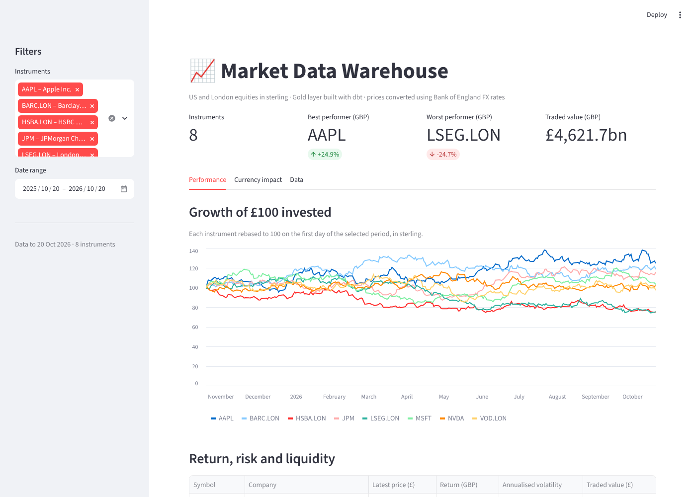

# Market Data Warehouse

A data warehouse of daily equity prices for US and London-listed stocks, converted to sterling with Bank of England FX rates and modelled as a **star schema in dbt**.
It runs locally on DuckDB for free, and is designed to move to **Azure** (ADLS Gen2, Azure Data Factory, Azure Databricks) without changing the models.

> **Status:** Week 0 – local build complete. Azure deployment in progress.

## Architecture

```
Alpha Vantage API ─┐                         ┌─ dim_date
(daily OHLCV)      │                         ├─ dim_instrument (SCD Type 2)
                   ├─► Bronze ─► raw ─► stg ─┼─ dim_currency
Bank of England ───┘   JSONL     DuckDB  dbt └─ fact_daily_prices ─► Power BI
(GBP FX rates)        (by ingest            (prices in local currency and GBP)
                                                    │
                                                    └─► Streamlit dashboard
                       date)
```

| Layer | Local (now) | Azure (Weeks 1–4) |
|---|---|---|
| Ingestion and orchestration | `python -m ingestion.run` | Azure Data Factory, daily trigger |
| Bronze storage | `data/bronze/` JSON Lines | ADLS Gen2 `bronze` container |
| Bronze → Silver | `ingestion/load_raw.py` | Azure Databricks (PySpark, Delta Lake) |
| Gold modelling | dbt on DuckDB | dbt on Databricks (`dbt-databricks`) |
| CI/CD | GitHub Actions on DuckDB | the same CI, plus a deploy job to `prod` |

## Data model

**Grain of `fact_daily_prices`:** one row per instrument per trading day.

| Table | Type | Key | Notes |
|---|---|---|---|
| `fact_daily_prices` | Fact | `price_key` | OHLC in listing currency, `close_gbp`, `traded_value_gbp`, `daily_return` |
| `dim_instrument` | Dimension, SCD 2 | `instrument_key` | Built from a dbt snapshot; facts join to the version valid on the trade date |
| `dim_date` | Dimension | `date_key` (YYYYMMDD) | Calendar attributes, weekend flag |
| `dim_currency` | Dimension | `currency_key` | GBP, USD, EUR |

## Design decisions

- **Incremental, idempotent ingestion.** A watermark per source records the last date loaded, and it can only move forward. Re-running a day lands nothing new, and staging deduplicates on `(symbol, trade_date)`, keeping the latest copy, so replays and backfills are safe.
- **Within the free API limit.** Alpha Vantage's free tier allows 25 requests a day and returns the latest ~100 trading days per call (full history is a premium feature). Each run makes one call per ticker, and the watermarks mean history builds up day by day. A failing ticker is logged and retried next run without stopping the others.
- **Correct currency conversion.** London prices are quoted in pence (GBX) and are divided by 100 before conversion. The Bank of England does not publish on UK bank holidays, so rates are forward-filled across every calendar day, and a test fails if a rate is carried forward for more than 5 days.
- **SCD Type 2 instruments.** Renames and sector changes are tracked by a dbt snapshot. The first version is back-dated so historical prices still join.
- **One codebase, two engines.** Engine-specific SQL (date series, forward fill, date formatting) sits behind dispatch macros in `dbt/macros/portable.sql`, so the same models run on DuckDB in CI and on Databricks in production.

## Dashboard

A Streamlit app (`dashboard/app.py`) reads only from the Gold star schema:

- **Performance:** growth of £100 invested in each stock, plus return, annualised volatility and traded value in GBP.
- **Currency impact:** how much USD/GBP moves added to or removed from a UK investor's return on US stocks.
- **Data:** the daily price table, filterable and downloadable as CSV.

```bash
streamlit run dashboard/app.py
```



## Data quality

- **29 dbt data tests:** unique and not-null keys, referential integrity from the fact to every dimension, and accepted values.
- **Custom tests:**
  - `assert_valid_price_bars` – positive prices and low ≤ open/close ≤ high.
  - `assert_fx_not_stale` – flags an FX feed that has stopped publishing.
  - `unique_combination` – a generic test for composite keys.
- **11 pytest tests:** parsing, API error handling (Alpha Vantage returns HTTP 200 on rate limits), watermark behaviour, an end-to-end rerun check, and a dashboard smoke test that renders the app against the built warehouse.

## Run it locally

```bash
python -m venv .venv && source .venv/bin/activate   # Windows: .venv\Scripts\activate
pip install -r requirements.txt

# 1. Offline demo with synthetic data (no API key needed)
python -m ingestion.run --sample
dbt build --project-dir dbt --profiles-dir dbt
pytest

# 2. Real data
cp .env.example .env              # add your free Alpha Vantage key
rm -rf data                       # clear the sample data
python -m ingestion.run --backfill   # first run: latest ~100 trading days (free tier), ~2 minutes
python -m ingestion.run              # every day after: new rows only
dbt build --project-dir dbt --profiles-dir dbt

# Open the dashboard in your browser
streamlit run dashboard/app.py

# Browse the lineage graph and documentation
dbt docs generate --project-dir dbt --profiles-dir dbt
dbt docs serve --project-dir dbt --profiles-dir dbt
```

To query the results, open `data/warehouse.duckdb` in DuckDB or DBeaver. The Gold tables are in the `gold` schema.

## Repository layout

```
ingestion/        API clients, Bronze writer, watermarks, raw loader, CLI
dbt/
  models/staging/       typed and deduplicated sources
  models/intermediate/  forward-filled daily FX rates
  models/marts/         star schema (Gold)
  snapshots/            SCD Type 2 instrument history
  seeds/                instrument and currency reference data
  macros/               cross-engine helpers (DuckDB / Databricks)
  tests/                custom data tests
dashboard/        Streamlit app over the Gold layer
tests/            pytest unit tests and dashboard smoke test
.github/workflows/ci.yml   runs pytest + ingestion + dbt build on every PR
```

## Roadmap

- [x] Week 0 – local pipeline, star schema, tests, CI
- [x] Streamlit dashboard over the Gold layer
- [ ] Week 1 – Azure resource group, ADLS Gen2, Key Vault, budget alert
- [ ] Week 2 – Azure Data Factory ingestion into ADLS `bronze`
- [ ] Week 3 – Azure Databricks Silver layer; dbt `prod` target on Databricks
- [ ] Week 4 – Power BI report; ADF orchestrates ingest → Databricks → dbt
- [ ] Stretch – natural-language Q&A over the Gold tables

*The sample mode generates synthetic prices for testing; it is not real market data.*
