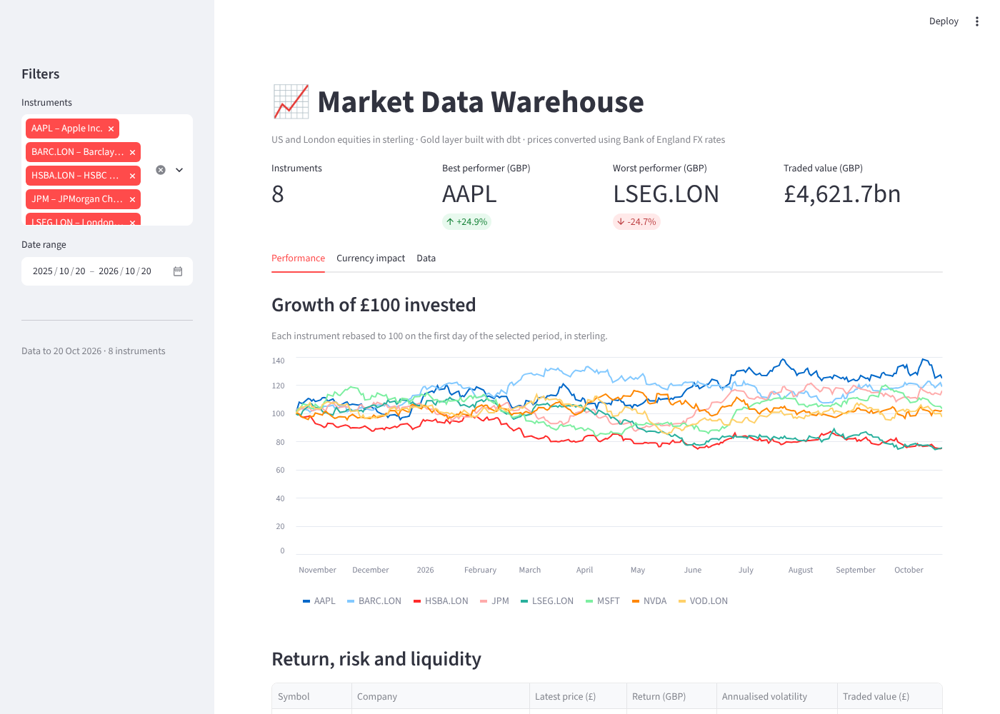

# Market Data Warehouse

A data warehouse of daily equity prices for US and London-listed stocks, converted to sterling with Bank of England FX rates and modelled as a **star schema in dbt**.
It runs locally on DuckDB for free, and is moving to **AWS** (S3, Glue Data Catalog, Athena), with the infrastructure defined in Terraform.

> **Status:** local build complete, with incremental models, unit tests and a model contract. AWS foundation (S3, IAM, budget) is in Terraform; the cloud pipeline is in progress.

## Architecture

```
Alpha Vantage API ─┐                         ┌─ dim_date
(daily OHLCV)      │                         ├─ dim_instrument (SCD Type 2)
                   ├─► Bronze ─► raw ─► stg ─┼─ dim_currency
Bank of England ───┘   JSONL     DuckDB  dbt └─ fact_daily_prices ─► Power BI
(GBP FX rates)        (by ingest            (prices in local currency and GBP)
                                                    │
                                                    └─► Streamlit dashboard
                       date)
```

| Layer | Local (now) | AWS (in progress) |
|---|---|---|
| Infrastructure | – | Terraform: S3 Bronze bucket, least-privilege IAM, cost budget (**done**) |
| Ingestion | `python -m ingestion.run` | the same code, writing to the S3 `bronze` bucket |
| Orchestration | run by hand | scheduled daily run (GitHub Actions cron or EventBridge) |
| Bronze → raw tables | `ingestion/load_raw.py` into DuckDB | Glue Data Catalog tables over S3 |
| Gold modelling | dbt on DuckDB | dbt on Athena (`dbt-athena`), `prod` target |
| CI/CD | GitHub Actions on DuckDB | the same CI, plus a deploy job to `prod` |

## Data model

**Grain of `fact_daily_prices`:** one row per instrument per trading day.

| Table | Type | Key | Notes |
|---|---|---|---|
| `fact_daily_prices` | Fact, incremental, contract enforced | `price_key` | OHLC in listing currency, `close_gbp`, `traded_value_gbp`, `daily_return_local`, `daily_return_gbp` |
| `dim_instrument` | Dimension, SCD 2 | `instrument_key` | Built from a dbt snapshot; facts join to the version valid on the trade date |
| `dim_date` | Dimension | `date_key` (YYYYMMDD) | Calendar attributes, weekend flag |
| `dim_currency` | Dimension | `currency_key` | GBP, USD, EUR |
| `monthly_performance` | Aggregate | `symbol`, `month_start` | Average close and month-on-month return in GBP |

## Design decisions

- **Incremental, idempotent ingestion.** A watermark per source records the last date loaded, and it can only move forward. Re-running a day lands nothing new, and staging deduplicates on `(symbol, trade_date)`, keeping the latest copy, so replays and backfills are safe.
- **Within the free API limit.** Alpha Vantage's free tier allows 25 requests a day and returns the latest ~100 trading days per call (full history is a premium feature). Each run makes one call per ticker, and the watermarks mean history builds up day by day. A failing ticker is logged and retried next run without stopping the others.
- **Correct currency conversion.** London prices are quoted in pence (GBX) and are divided by 100 before conversion. The Bank of England does not publish on UK bank holidays, so rates are forward-filled across every calendar day, and a test fails if a rate is carried forward for more than 5 days.
- **Incremental fact table.** `fact_daily_prices` only rewrites the last 10 days on each run (`fact_lookback_days`), reading twice that window so the day-on-day return is still correct for the first rewritten row. Late corrections inside the window are picked up; `--full-refresh` rebuilds everything. It uses `delete+insert` on DuckDB and `merge` on engines that support it.
- **Contract on the fact table.** Column names and types are enforced, so a change that would break the dashboard fails the build instead.
- **SCD Type 2 instruments.** Renames and sector changes are tracked by a dbt snapshot. The first version is back-dated so historical prices still join.
- **Portable SQL.** Engine-specific SQL (date series, forward fill, date formatting) sits behind `adapter.dispatch` macros in `dbt/macros/portable.sql`. DuckDB and Databricks versions exist; Athena versions are the next step for the AWS `prod` target.

## Dashboard

A Streamlit app (`dashboard/app.py`) reads only from the Gold star schema:

- **Performance:** growth of £100 invested in each stock, plus return, annualised volatility and traded value in GBP.
- **Currency impact:** how much USD/GBP moves added to or removed from a UK investor's return on US stocks.
- **Data:** the daily price table, filterable and downloadable as CSV.

```bash
streamlit run dashboard/app.py
```



## Data quality

- **35 dbt data tests:** unique and not-null keys, referential integrity from the fact to every dimension, accepted values, and `dbt_utils.accepted_range` on GBP prices.
- **Custom tests:**
  - `assert_valid_price_bars` – positive prices and low ≤ open/close ≤ high.
  - `assert_fx_not_stale` – flags an FX feed that has stopped publishing.
  - `assert_every_symbol_has_instrument` – an ingested ticker missing from the seed would otherwise silently drop out of Gold.
  - `unique_combination` – a generic test for composite keys.
- **3 dbt unit tests** (fixed inputs, expected outputs, no warehouse data needed):
  - the SCD Type 2 point-in-time join picks the instrument version valid on each trade date, and pence are converted to pounds;
  - USD prices convert to GBP, and the sterling return includes the currency move;
  - monthly return is month-on-month, not first-to-last day within a month.
- **Source freshness:** warns if no new data has landed for 4 days and fails after 6 (`dbt source freshness`).
- **13 pytest tests:** parsing, API error handling (Alpha Vantage returns HTTP 200 on rate limits), watermark behaviour, an end-to-end rerun check, a check that the ticker list matches the instrument seed, and a dashboard smoke test that renders the app against the built warehouse.

## Run it locally

```bash
python -m venv .venv && source .venv/bin/activate   # Windows: .venv\Scripts\activate
pip install -r requirements.txt

# 1. Offline demo with synthetic data (no API key needed)
python -m ingestion.run --sample
dbt deps --project-dir dbt --profiles-dir dbt     # installs dbt_utils
dbt build --project-dir dbt --profiles-dir dbt
pytest

# 2. Real data
cp .env.example .env              # add your free Alpha Vantage key
rm -rf data                       # clear the sample data
python -m ingestion.run --backfill   # first run: latest ~100 trading days (free tier), ~2 minutes
python -m ingestion.run              # every day after: new rows only
dbt build --project-dir dbt --profiles-dir dbt

# Open the dashboard in your browser
streamlit run dashboard/app.py

# Browse the lineage graph and documentation
dbt docs generate --project-dir dbt --profiles-dir dbt
dbt docs serve --project-dir dbt --profiles-dir dbt
```

To query the results, open `data/warehouse.duckdb` in DuckDB or DBeaver. The Gold tables are in the `gold` schema.

## Repository layout

```
ingestion/        API clients, Bronze writer, watermarks, raw loader, CLI
dbt/
  models/staging/       typed and deduplicated sources
  models/intermediate/  forward-filled daily FX rates
  models/marts/         star schema (Gold)
  snapshots/            SCD Type 2 instrument history
  seeds/                instrument and currency reference data
  macros/               cross-engine helpers (adapter.dispatch)
  tests/                custom data tests
dashboard/        Streamlit app over the Gold layer
tests/            pytest unit tests and dashboard smoke test
infra/terraform/  AWS: S3 Bronze bucket, IAM, budget
.github/workflows/ci.yml   pytest, ingestion, freshness, dbt build (twice, to test the incremental path)
```

## Roadmap

- [x] Local pipeline, star schema, tests, CI
- [x] Streamlit dashboard over the Gold layer
- [x] dbt depth: incremental fact, unit tests, contract, source freshness, exposure, dbt_utils
- [x] AWS foundation in Terraform: S3 Bronze bucket, least-privilege IAM, cost budget
- [ ] Ingestion writes Bronze and watermarks to S3
- [ ] Glue Data Catalog over Bronze; dbt `prod` target on Athena with `athena__` dispatch macros
- [ ] Scheduled daily run; CI deploy job to `prod` on merge; slim CI with `state:modified+`
- [ ] dbt docs hosted on GitHub Pages
- [ ] Stretch – natural-language Q&A over the Gold tables

*The sample mode generates synthetic prices for testing; it is not real market data.*
